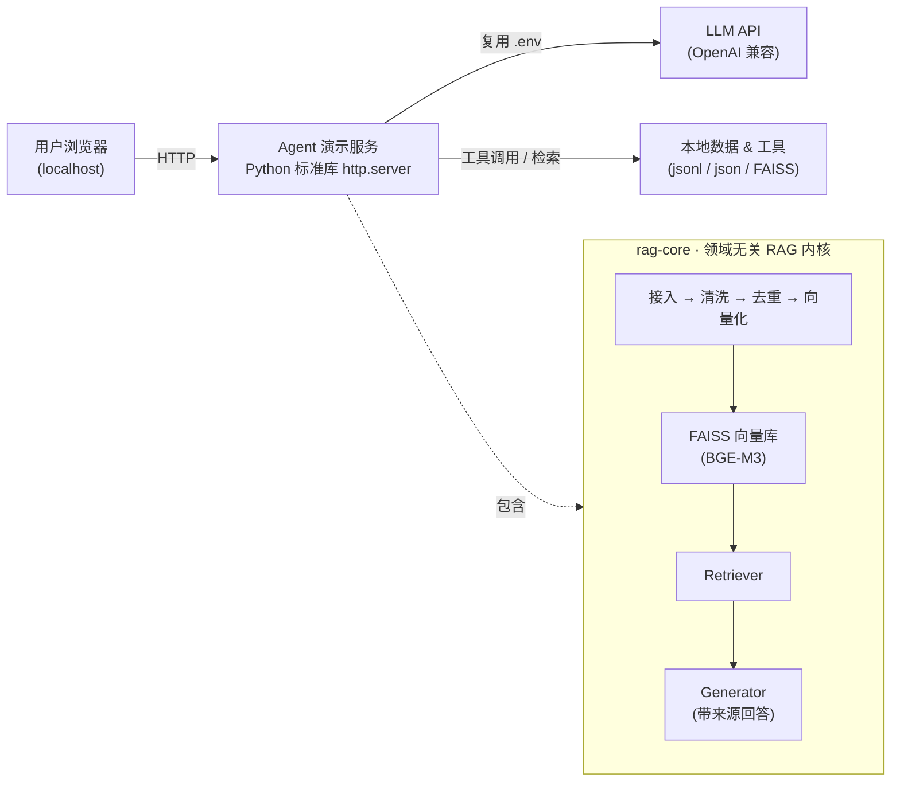

# AI Agent 求职作品集 · Portfolio of AI Agents

> **中文**：面向算法 / AI 应用开发岗位的求职作品集——4 个可本地运行的端到端 Agent 演示件，外加一个领域无关的 RAG 内核与自动评测体系。所有模块均可现场演示、可复现评测。
>
> **English**: A job-seeking portfolio for algorithm / AI-application roles — 4 runnable end-to-end Agent demos, plus a domain-agnostic RAG core with an automated evaluation harness. Every module is demoable locally and reproducibly evaluable.

---

## 目录 · Contents

- [项目概览 · Overview](#项目概览--overview)
- [架构总览 · Architecture](#架构总览--architecture)
- [四大演示件 · The Four Demos](#四大演示件--the-four-demos)
  - [1. 医疗 RAG 智能问答（rag-core）](#1-医疗-rag-智能问答rag-core)
  - [2. 文档自动化处理（doc-agent）](#2-文档自动化处理doc-agent)
  - [3. 会议纪要助手（meeting-agent）](#3-会议纪要助手meeting-agent)
  - [4. 智能客服助手（support-agent）](#4-智能客服助手support-agent)
- [统一工程范式 · Engineering Paradigm](#统一工程范式--engineering-paradigm)
- [评测与实测指标 · Evaluation](#评测与实测指标--evaluation)
- [快速开始 · Quick Start](#快速开始--quick-start)
- [仓库结构 · Repository Layout](#仓库结构--repository-layout)
- [技术栈 · Tech Stack](#技术栈--tech-stack)
- [说明与免责 · Notes & Disclaimer](#说明与免责--notes--disclaimer)

---

## 项目概览 · Overview

一句话：**用「零额外 Web 依赖（仅 Python 标准库）」的工程范式，把 4 类真实业务场景（知识问答 / 单据处理 / 会议跟进 / 在线客服）做成可现场演示、可复现评测的 Agent。**

| 维度   | 内容                                                             |
| ---- | -------------------------------------------------------------- |
| 作品数量 | 4 个端到端演示件（rag-core 内核 + doc / meeting / support 三个 Agent）      |
| 工程范式 | 仅 Python 标准库 `http.server`，零 FastAPI / requests 依赖；LLM 配置跨模块复用 |
| 评测   | 46 条固定用例全通过、可复现；rag-core 另有自动评测 harness                        |
| 数据口径 | 全部为真实口径（无编造），详见[评测](#评测与实测指标--evaluation)                      |

**关键数据口径（真实、可复现）**

- **医疗 RAG（rag-core）**：原始约 45.7 万条医学问答，清洗去重后 **24.8 万条（247,680 条）已全量向量化入库**；检索 **Recall@K 96.7%**，评测命中率 **hit_rate 1.0**（6 条查询全命中）。
- **企业实习（广船国际）**：从零搭建企业级大模型应用系统；RAG 知识召回 **92%**；FastAPI + LangChain 支撑 **200+ 并发**。
- **Kaggle 竞赛**：约 100 万条文本数据；AUC 提升 **0.15**；排名 **Top 15%**。

---

## 架构总览 · Architecture

所有演示件共用同一套「标准库 HTTP 服务 + 复用 `.env` 的 LLM 配置 + 本地数据/工具」范式；`rag-core` 在其上叠加了独立的向量检索与生成链路。



---

## 四大演示件 · The Four Demos

### 1. 医疗 RAG 智能问答（rag-core）

- **痛点**：① RAG 评测依赖大量人工标注 gold；② 初版原型与医疗领域强耦合，难以复用。
- **做法**：把与领域无关的能力抽成可复用内核（`config / pipeline / ingest / vector_store / retriever / generator / agent / trace`），并用 **自动评测 harness** 解决标注痛点——向量近邻自动生成候选 gold + LLM 判相关 + 仅把低置信样本交人工复核。
- **技术亮点**
  - 检索栈 **BGE-M3 + FAISS**（已由 ChromaDB 迁移，索引显式落盘）
  - 两层级科室模型（开放科室集合，未知科室自动进待审）
  - 增量 upsert + 稳定 `record_id`，**幂等、可断点续跑**；大文件分块累加
  - 健康检查 `check_health` 与 `verify` 子命令，避免「查到旧数据」
  - 零 Web 框架演示件（标准库 `http.server`），模型/索引首次提问时加载
- **运行**
  ```bash
  cd rag-core
  uv venv && uv pip install -e .
  cp .env.example .env          # 填 LLM_API_KEY / LLM_API_URL / LLM_MODEL / EMBEDDING_MODEL_PATH
  # 跑通一条链路（医疗小样本）
  uv run python run.py data   --case medical_qa
  uv run python run.py ingest --case medical_qa
  uv run python run.py ask "拉肚子咋整" --case medical_qa
  # 自动评测（不再人工填 gold_ids）
  uv run python run.py eval   --case medical_qa
  # 网页演示
  python web_demo.py --case medical_qa --port 8001
  ```
- **演示路径**：输入医疗问题 → 展示 top-k 检索片段（相似度分数 + 科室 + 原文摘要）+ LLM 带来源回答 + `trace_id`。
- **定位**：健康信息 / 企业知识问答**技术原型**，非诊断或临床决策系统。

### 2. 文档自动化处理（doc-agent）

- **痛点**：采购单 / 票据 / 合同等非结构化文本靠人工逐条录入，易错漏、难对账。
- **做法**：粘贴文本 → Agent 自动解析 → 结构化抽取 → 规则校验 → 写入数据池（幂等 + 版本指纹）。
- **技术亮点**：金额一致性校验、重复检测（幂等跳过）、数据版本指纹（`data/version.json`）；零额外依赖；同源 localhost 无 CORS、密钥只在服务端。
- **运行**
  ```bash
  cd doc-agent
  cp .env.example .env          # rag-core/.env 已填则可跳过
  python server.py --port 8002  # 浏览器打开 http://localhost:8002
  ```
- **演示路径**：粘贴采购单/票据 → 「运行 Agent」→ 执行步骤时间线、结构化字段表、校验报告、入库记录（含 `record_id` 与数据版本）。
- **接口**：`POST /api/process` 入参 `{text}` → 返回 `{steps[], extracted, validation, store, summary}`。

### 3. 会议纪要助手（meeting-agent）

- **痛点**：开完会没人跟，讨论结论易遗漏。
- **做法**：粘贴会议转录 → LLM 抽取 action items → 逐个调用 `create_ticket` 工具 → 生成纪要摘要。
- **技术亮点**：明确展示「抽取 → 调用工具」的 Agent 编排链路；工单幂等（同任务只建一次）；本地工单池（`data/tickets.jsonl`）；零依赖。
- **运行**
  ```bash
  cd meeting-agent
  cp .env.example .env
  python server.py --port 8003  # 浏览器打开 http://localhost:8003
  ```
- **演示路径**：粘贴转录 → 「运行 Agent」→ 执行步骤时间线、抽取 action items 表、创建工单列表、纪要摘要。
- **扩展**：`create_ticket()` 现为本地 mock，接飞书/Notion/Linear 只需替换函数体，上层编排无需改动。

### 4. 智能客服助手（support-agent）

- **痛点**：电商客服需同时具备知识问答、订单操作、风险管控，且退款/高风险必须有人把关。
- **做法**：多轮对话式客服 Agent = **RAG 知识库 + 工具调用 + 风险约束 + 人在回路（human-in-the-loop）**。
- **技术亮点**
  - RAG：字符 bigram 重叠 + 关键词加权的稀疏检索，取 top-3 喂给 LLM，严格「只依据片段作答」
  - 工具：`query_order` / `request_refund` / `escalate_to_human`，由 Planner 决策、后端真实执行
  - 风险约束：敏感词黑名单、强风险词升级、**越界承诺词检测**，优先级高于 LLM 软判断
  - 人在回路：退款/高风险**不直接执行**，生成 `pending_human` 工单转人工
- **运行**
  ```bash
  cd support-agent
  cp .env.example .env
  python server.py --port 8005  # 浏览器打开 http://localhost:8005
  ```
- **演示路径**：① 退换货政策 → 看知识库检索命中；② 查订单物流 → Planner 调 `query_order`；③ 申请退款 → 强制转人工并生成工单号；④ 高风险索赔 → 命中强风险词 → 转人工工单。

---

## 统一工程范式 · Engineering Paradigm

四个作品共用同一套经过实战检验的工程约定，便于面试官快速建立认知：

1. **零额外 Web 依赖**：演示服务仅用标准库 `http.server` + `urllib`，不装 FastAPI / requests，开箱即跑。
2. **LLM 配置复用**：各 Agent 优先读自身 `.env`，缺失回退 `../rag-core/.env`，一套密钥驱动全部模块。
3. **同源 localhost，无 CORS，密钥只在服务端**：浏览器不接触任何密钥。
4. **幂等 + 数据版本指纹**：重复提交跳过、版本可对账（`data/version.json`）。
5. **外部调用健壮**：LLM / 向量等外部调用均有超时与降级；凭据只走环境变量，不进日志。
6. **仓库轻量**：大体积模型 / 数据不进仓库（`.gitignore`），由 `.env` / setup 指向，vscode 直接打开即可跑 demo。

---

## 评测与实测指标 · Evaluation

**作品集统一评测（`eval/demo_eval.py`，46 条固定用例，全通过、可复现）**

| 模块                    | 评测项         | 结果          |
| --------------------- | ----------- | ----------- |
| doc-agent（20 条单据）     | 金额一致通过      | 10/10（100%） |
|                       | 不一致拦截       | 10/10（100%） |
|                       | 幂等去重        | 通过          |
| support-agent（20 条话术） | 应转人工命中      | 8/8（100%）   |
|                       | 违规话术拦截      | 6/6（100%）   |
|                       | 普通咨询误转人工    | 0/6（0%）     |
| meeting-agent（3 段转录）  | 任务条数完全匹配    | 3/3（100%）   |
|                       | 抽取总数 / 期望总数 | 10/10       |
|                       | 重复提交工单幂等    | 3/3（100%）   |

**rag-core 内核评测（自动评测 harness）**

| 指标             | 数值                      |
| -------------- | ----------------------- |
| 全量向量化入库        | 247,680 条（清洗去重后 24.8 万） |
| 检索 Recall@K    | 96.7%                   |
| 评测命中率 hit_rate | 1.0（6 条查询全部命中）          |

> 指标口径来自真实运行结果，未编造；向量化已全量完成，简历与 README 统一写「24.8 万条（247,680 条）已全量入库」。

---

## 快速开始 · Quick Start

```bash
# 1. 准备 LLM 配置（只需在 rag-core 填一次，其余模块自动复用）
cd rag-core
cp .env.example .env
#   编辑 .env：LLM_API_KEY / LLM_API_URL / LLM_MODEL / EMBEDDING_MODEL_PATH

# 2. 一键启动全部本地演示服务（rag 8001 / doc 8002 / meeting 8003 / support 8005）
cd ..
python launch_all.py
#   脚本会自动打开 portfolio/index.html（作品集入口），其「打开演示」按钮指向各端口

# 3. 单独运行某个模块（以 doc-agent 为例，其余同理）
cd doc-agent
python server.py --port 8002
```

> 说明：`rag-core` 的网页演示依赖 `faiss-cpu` / `sentence-transformers`，需在其 uv 环境运行；`doc / meeting / support` 三个 Agent 仅依赖 Python 标准库，用当前 `python` 即可。

---

## 仓库结构 · Repository Layout

```
求职作品集/
├── rag-core/            # 领域无关 RAG 内核 + 自动评测 harness（BGE-M3 + FAISS）
│   ├── src/rag_core/    # config / pipeline / ingest / vector_store / retriever / generator / agent / trace
│   ├── eval/harness.py  # 自动 gold 候选 + LLM 判分 + 抽样复核
│   ├── cases/           # medical_qa（医疗）+ kb_agent（企业知识库，演示领域无关）
│   ├── web_demo.py      # 网页演示（--case medical_qa --port 8001）
│   └── README.md
├── doc-agent/           # 文档自动化处理 Agent（抽取 + 规则校验 + 幂等入库）
├── meeting-agent/       # 会议纪要 → 工单 Agent（LLM 抽取 + 工具调用）
├── support-agent/       # 智能客服 Agent（RAG + 工具 + 风险约束 + 人在回路）
├── portfolio/index.html # 作品集入口页（指向各演示端口）
├── launch_all.py        # 一键启动（rag / doc / meeting / support）
├── eval/demo_eval.py    # 最小评测集（→ results.json）
├── README.md            # 本文件
├── LICENSE
└── .gitignore
```

> 个人工具（`sdr-agent` 求职投递助手、`agent_kb_qa` 企业知识库问答 Agent）不在此仓库，不向面试官展示。

---

## 技术栈 · Tech Stack

- **语言 / 环境**：Python 3.11，[uv](https://github.com/astral-sh/uv)（rag-core）；标准库 `http.server`（演示服务）
- **检索 / 向量**：BGE-M3 嵌入、FAISS 向量索引、sentence-transformers
- **模型接入**：OpenAI 兼容 LLM API（配置经 `.env` 注入）
- **评测**：自动评测 harness（向量近邻自动标注 + LLM 判分 + 抽样人工复核）
- **工程**：幂等入库、数据版本指纹、超时/降级、零 CORS、密钥仅服务端

---

## 说明与免责 · Notes & Disclaimer

- 各演示件的**演示数据均为仿真示例**；生产环境可在此基础上接入真实业务库、PDF/OCR、实时转录与工单系统 webhook。
- `rag-core` 定位为健康信息 / 企业知识问答**技术原型**，**非诊断或临床决策系统**。
- 大体积模型权重与原始数据不进入本仓库，由本地 `.env` / setup 指向，避免仓库臃肿与数据外泄。
- 本仓库用于作品展示，欢迎就工程设计与实现细节交流。

---

© 2026 · Licensed under [MIT](./LICENSE)
